## Overview

This project demonstrates how to configure a minimal Debian router to allow two machines on different IPv4 networks to communicate.

At first, the client and server are connected to separate internal networks. Because the machines are on different subnets, they cannot communicate directly. A Debian machine with an interface on each network can route packets between them.

## Lab topology

| Machine | Role | Internal network | IP address |
|---|---|---|---|
| Client | Client machine | `lab-client` | `192.168.10.1/24` |
| Server | Server machine | `lab-server` | `192.168.20.1/24` |
| Debian router | Router | Connected to both internal networks | See the router configuration below |

## Configure the client and server networks

Configure the client on the `192.168.10.0/24` network.
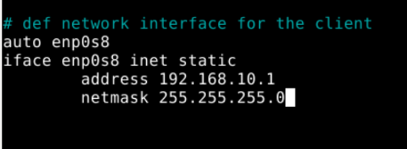

Configure the server on the `192.168.20.0/24` network.
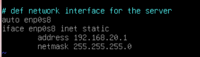

Restart networking after changing `/etc/network/interfaces`:

```bash
sudo systemctl restart networking.service
```

Check the interface addresses:

```bash
ip -br a
```

Client:
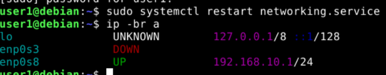

Server:
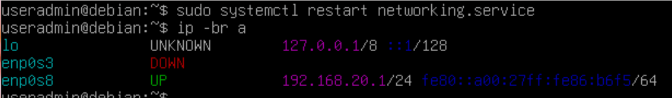

In this VirtualBox setup, `enp0s3` corresponds to the NAT adapter, which is disabled for this demonstration. The `enp0s8` interface connects the client and server VMs to their respective internal networks. Interface names may vary between systems, so verify them with `ip -br address`.

## Confirm the initial connectivity problem

The client and server are on different IP subnets. Without a router or another configured Layer 3 path, they cannot communicate directly.

For example, a ping from the server to the client fails:


This is the problem the router will solve.

## VirtualBox Network Configuration

Before configuring the Debian router, I created two separate Internal Networks in VirtualBox: `lab-client` and `lab-server`.

The router has one network adapter connected to each internal network, allowing it to communicate with devices on both subnets.

#### Adapter 2 — Client Network

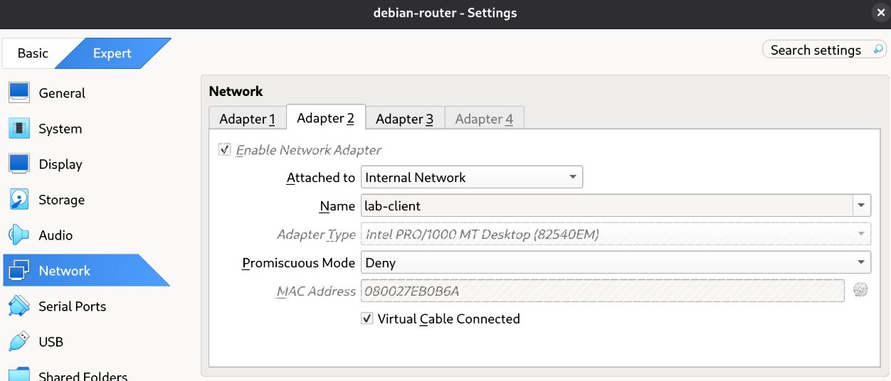
Adapter 2 is connected to the `lab-client` Internal Network.

#### Adapter 3 — Server Network

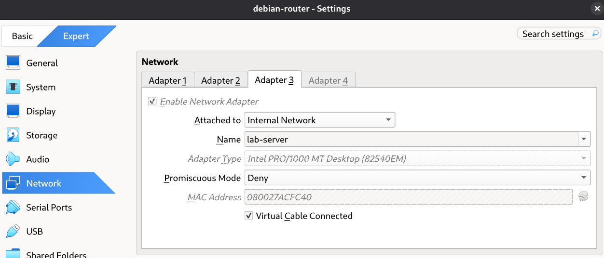
Adapter 3 is connected to the `lab-server` Internal Network.

## Configure the Debian router

The router needs two network interfaces to connect the two internal networks.

For this demonstration, the NAT adapter (`enp0s3`) is disabled on all three virtual machines. This allows the lab to focus exclusively on routing traffic between the two internal networks.

Edit the router's network configuration:

```bash
sudo nano /etc/network/interfaces
```

Configure the router's internal interfaces with static IP addresses in the corresponding subnets. The client-facing interface must have an address in `192.168.10.0/24`, and the server-facing interface must have an address in `192.168.20.0/24`.

The router is configured as follows:
- `enp0s8`: connected to `lab-client`, with IP address `192.168.10.254/24`.
- `enp0s9`: connected to `lab-server`, with IP address `192.168.20.254/24`.
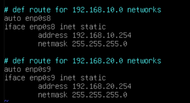

Apply the configuration:

```bash
sudo systemctl restart networking.service
```

Verify the interfaces:

```bash
ip -br address
```
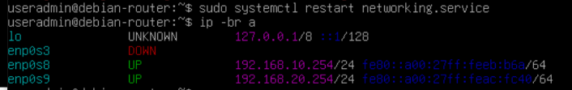

## Enable IPv4 packet forwarding

A Linux machine does not route IPv4 packets between interfaces unless IP forwarding is enabled.

Enable forwarding for the current session:

```bash
sudo sysctl -w net.ipv4.ip_forward=1
```

Verify the setting:

```bash
sudo sysctl net.ipv4.ip_forward
```

The expected result is:

```text
net.ipv4.ip_forward = 1
```
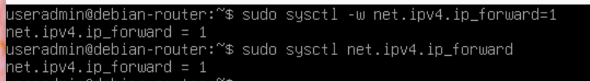

## Configure the default gateway on the client and server

Each machine needs a default gateway pointing to the router interface on its own subnet.

### Client

Set the default gateway to the router's address on `192.168.10.0/24`.
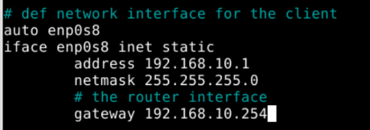

Restart networking:

```bash
sudo systemctl restart networking.service
```

Check the routing table:

```bash
ip route
```

The default route should point to the router's client-facing IP address.
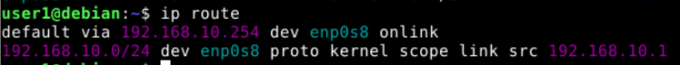

### Server

Set the default gateway to the router's address on `192.168.20.0/24`.
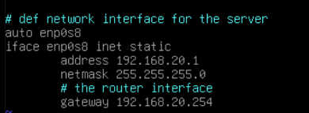

Restart networking:

```bash
sudo systemctl restart networking.service
```

Check the routing table:

```bash
ip route
```

The default route should point to the router's server-facing IP address.
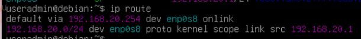

## Test connectivity

From the client, ping the server:

```bash
ping 192.168.20.1
```

If the IP addresses, gateways, interfaces, and forwarding setting are correct, the client should receive replies from the server.
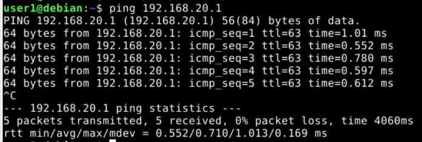

The router is now forwarding IPv4 traffic between the two internal networks.

## Make IP forwarding persistent on your router

The command `sysctl -w net.ipv4.ip_forward=1` changes the setting at runtime. To keep IPv4 forwarding enabled after a reboot, create a configuration file:

```bash
sudo nano /etc/sysctl.d/99-router.conf
```

Add this line:

```text
net.ipv4.ip_forward=1
```

Apply the system settings and verify the result:

```bash
sudo sysctl --system
sysctl net.ipv4.ip_forward
```

The output should include:

```text
net.ipv4.ip_forward = 1
```

## Possible next steps

- [ ] Configure the router to provide internet access to the client and server.
- [ ] Add DHCP so client machines can obtain their network configuration automatically.
- [ ] Set up DNS resolution for the lab.
- [ ] Add firewall rules to control traffic between the networks.
